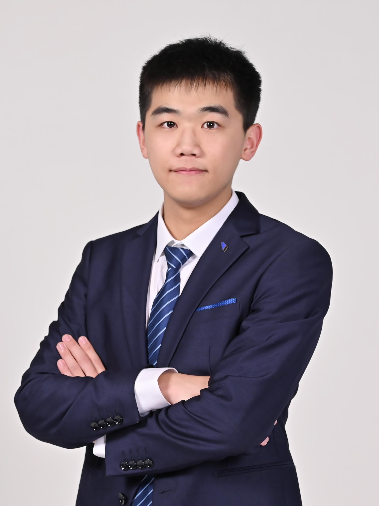

<head>

</head>

  <picture>
    <!-- Banner is hidden on phones: serve a 1x1 placeholder so they never download it -->
    <source media="(max-width: 600px)" srcset="data:image/gif;base64,R0lGODlhAQABAIAAAAAAAP///yH5BAEAAAAALAAAAAABAAEAAAIBRAA7" />
    
  </picture>

  

    <!-- Hidden entrance to the photo gallery: the camera badge appears on hover -->
    <a class="profile-photo-link" href="/gallery.html" title="More photos" aria-label="View photo gallery">
      
      <svg viewBox="0 0 24 24" width="16" height="16" fill="none" stroke="currentColor" stroke-width="2" stroke-linecap="round" stroke-linejoin="round"><path d="M23 19a2 2 0 0 1-2 2H3a2 2 0 0 1-2-2V8a2 2 0 0 1 2-2h4l2-3h6l2 3h4a2 2 0 0 1 2 2z"/><circle cx="12" cy="13" r="4"/></svg>
    </a>
    

      
Bruce (Siyuan) Jin (金思远)

      <!-- 2026-11-23 (Bruce): sidebar trimmed to email and outside profiles. The HKUST and Wharton rows repeated the bio,
           and CV, Research, Awards and Service repeated the top bar. -->
      

        Email
        <a href="mailto:siyuan.jin@connect.ust.hk">siyuan.jin@connect.ust.hk</a>
      

      

        <a href="https://scholar.google.com/citations?user=uki4jU4AAAAJ" target="_blank" rel="noopener noreferrer">Google Scholar</a>
        <a href="https://www.linkedin.com/in/si-yuan-bruce-jin" target="_blank" rel="noopener noreferrer">LinkedIn</a>
        <a href="https://github.com/siyuan-bruce" target="_blank" rel="noopener noreferrer">GitHub</a>
      

    

  

  

    <!-- 2026-11-15 (Bruce): "make this part more concise". -->
    

      <strong>Bruce (Siyuan) Jin (金思远)</strong> is a PhD candidate in Information Systems at HKUST Business School, advised by <a href="https://isom.hkust.edu.hk/faculty-and-staff/directory/kytam">Kar Yan Tam</a>, and a visiting scholar at the Wharton School with <a href="https://oid.wharton.upenn.edu/profile/wulynn/">Lynn Wu</a> through December 2026. <strong>He is on the 2026&ndash;2027 job market.</strong>
    

    

      His research asks how blockchain creates value in digital markets and how generative AI reshapes the organization of expertise inside firms. His work appears in the <em>Journal of Management Information Systems</em> (JMIS, FT50), and two papers are in revision at <em>Information Systems Research</em>.
    

    

      He has contributed to HKMA white papers on central bank digital currencies and quantum computing, and his <a href="/policy.html">policy work</a> has been covered by more than 70 news outlets. Before HKUST, he spent two years as a blockchain engineer at the <a href="https://www.ventures.hsbc.com/en/about-us">HSBC Laboratory</a>.
    

    <!-- 2026-11-21 (Bruce): reviewing and the IS Reading Group left the bio (Service page; Best Reviewer Award under Research > Awards). The policy paragraph is two sentences; outlet names and the 2021 Global CBDC Challenge finals sit on the Policy page. -->
  

<!-- 2026-11-21 (Bruce): "no need to show research streams we already introduced in the text". The streams live on the Research page. -->


<h2 class="talks-heading">Upcoming Talks</h2>

  
  

    

      {{ talk.month }}
      {{ talk.day }}
      {{ talk.year }}
    

    

      

        <a href="{{ talk.url }}" target="_blank" rel="noopener noreferrer">{{ talk.venue }}</a>{{ talk.venue }}
      

      
{{ talk.session }}

      

        <a href="/research.html#{{ talk.paper }}" title="{{ talk.title }}">{{ talk.short | default: talk.title }}</a>{{ talk.title }}
        {{ talk.place }}
        Presented by {{ talk.speaker }}
        {{ talk.time }}
        {{ talk.room }}
      

    

  

  



<!-- 2026-11-24 (Bruce): Curriculum Vitae section dropped; it duplicated the CV link in the top bar. -->

<h2 class="news-heading">News</h2>

  

    2026
    9 highlights
  

  <!-- 2026-11-25 (Bruce): JMIS paper published; link the AI-made video -->
  

    
Nov 2026

    Paper
    

      My MPhil thesis paper, <a href="/research.html#mining-to-meaning">From Mining to Meaning</a>, is published in <strong><em>Journal of Management Information Systems</em></strong> 43(4). Watch the <a href="/paper/From_Mining_to_Meaning_video.mp4">short video</a> I made with AI.
    

  

  

    
Aug 2026

    Paper
    

      Paper on AI adoption and team expansion accepted at <strong>CIST 2026</strong>.
    

  

  

    
Aug 2026

    Paper
    

      Paper on ambient information and selective entry (mobile widgets) accepted at <strong>CIST 2026</strong>.
    

  

  

    
Jul 2026

    Talk
    

      Two papers accepted to the <strong>MISQ Virtual Paper Development Workshop</strong>.
    

  

  

    
2026

    Paper
    

      Papers accepted at <strong><em>Journal of Management Information Systems</em></strong> (JMIS, FT50) and <strong><em>ACM Transactions on Management Information Systems</em></strong> (TMIS).
    

  

  

    
Jun 2026

    Talk
    

      Paper on AI adoption and time-zone frictions in global software teams selected for the <strong>HKUST IS Summer Workshop 2026</strong>.
    

  

  

    
May 2026

    Talk
    

      Papers accepted to the <strong>INFORMS Annual Meeting 2026</strong> and <strong>CNAIS ISR Paper Development Workshop</strong>.
    

  

  

    
May 2026

    Honor
    

      Selected for the <strong>PACIS 2026 Doctoral Consortium</strong>.
    

  

  

    
Mar 2026

    Lecture
    

      Invited as a guest lecturer on blockchain at <strong>South China University of Technology</strong>.
    

  

  

    
Show earlier news (27 updates from 2025 and before)

    

      

        2025
        13 updates
      

      

        
Dec 2025

        Service
        

          Received the Best Reviewer Award at <strong>ICIS 2025</strong>.
        

      

      

        
Dec 2025

        Grant
        

          Awarded the <strong>NSFC Young Student Basic Research Program</strong> grant (PhD Student, 2026–2027, 300K RMB).
        

      

      

        
Dec 2025

        Honor
        

          Paper on seniority and AI-augmented code contributions nominated for the <strong>ICIS 2025 Best Short Paper Award</strong>.
        

      

      

        
Oct 2025

        Paper
        

          Paper on stablecoin transparency accepted at <strong>CIST 2025</strong>.
        

      

      

        
Jul 2025

        Paper
        

          Paper on Copilot's impact accepted at <strong>ICIS 2025</strong>.
        

      

      

        
Jun 2025

        Talk
        

          Paper on blockchain-based K-Pop community selected for the <strong>HKUST IS Summer Workshop 2025</strong>.
        

      

      

        
Jun 2025

        Paper
        

          Paper on consumer perception of rCBDC adoption accepted at
          <strong><a href="https://dl.acm.org/doi/10.1145/3756329">ACM Distributed Ledger Technologies: Research and Practice</a></strong>.
        

      

      

        
Apr 2025

        Paper
        

          Paper on code review accepted at <strong>SCECR 2025</strong>.
        

      

      

        
Apr 2025

        Paper
        

          Paper on stablecoin transparency accepted at <strong>SCECR 2025</strong>.
        

      

      

        
Apr 2025

        Talk
        

          Presented at the <strong>2025 HKUST PhD Student Conference</strong>.
        

      

      

        
Mar 2025

        Service
        

          Selected as a mentor for the <strong>2025 HKUST Web3 Ideathon Competition</strong>.
        

      

      

        
Mar 2025

        Service
        

          <strong>IS Reading Group</strong> reached over 100 members.
        

      

      

        
Feb 2025

        Paper
        

          Paper on root cause analysis accepted at <strong>AIOps 2025</strong>.
        

      

      

        2024
        11 updates
      

      

        
Dec 2025

        Service
        

          Selected to participate in the <strong>MISQ Reviewer Workshop</strong>.
        

      

      

        
Dec 2024

        Award
        

          Received the <strong>HKUST Young Scientists Program Award (FinTech)</strong>.
        

      

      

        
Nov 2024

        Honor
        

          Paper on blockchain-based K-Pop community nominated for the <strong>ICIS 2024 Best Short Paper Award</strong>.
        

      

      

        
Nov 2024

        Talk
        

          Presented research on blockchain infrastructure governance at the <strong>2024 Greater Bay Area Finance Workshop</strong>.
        

      

      

        
Aug 2024

        Paper
        

          Paper on blockchain-based K-Pop community accepted at <strong>CIST 2024</strong>.
        

      

      

        
Aug 2024

        Paper
        

          Paper on code review accepted at <strong>CIST 2024</strong>.
        

      

      

        
Jul 2024

        Paper
        

          Paper on blockchain-based K-Pop community accepted at the <strong>ICIS 2024 Fintech Track</strong>.
        

      

      

        
Jul 2024

        Paper
        

          Paper on stablecoin transparency accepted at <strong>ICIS 2024</strong>.
        

      

      

        
Jul 2024

        Milestone
        

          Successfully passed the <strong>PhD Qualification Exam</strong> and advanced to candidacy.
        

      

      

        
Jun 2024

        Service
        

          Paper accepted for the <strong>MIS Quarterly Virtual Paper Development Workshop</strong>.
        

      

      

        
May 2024

        Talk
        

          Presented at the <strong>HKUST PhD Student Conference</strong>.
        

      

      

        2023
        2 updates
      

      

        
Oct 2023

        Paper
        

          Joint policy paper "e-HKD Pilot Programme" published by the <a href="https://www.hkma.gov.hk/media/eng/doc/key-information/press-release/2023/20231030e3a1.pdf"><strong>HKMA</strong></a>.
        

      

      

        
Sep 2023

        Paper
        

          Paper on software metrics distributions accepted at <strong>QRS 2023</strong>.
        

      

      

        2022
        1 update
      

      

        
Dec 2022

        Service
        

          Selected as a mentor for the <strong>2022 HKUST Fintechstic Competition</strong>.
        

      

    

  

<!-- 2026-11-21 (Bruce): "drop the visitor count". -->

<meta name="viewport" content="width=device-width, initial-scale=1">
