<head>
<link rel="stylesheet" href="/assets/css/site-pages.css">

</head>

An online paper series where IS scholars discuss papers, ideally with their authors, with 40+ sessions in 2024&ndash;2025. Faculty and practitioners are welcome. Our motto: one more critique makes the paper better.

Weibo Li (ASU) now leads the group. To join or present, email <a href="mailto:weiboli@asu.edu">weiboli@asu.edu</a>.

<h3 class="sec" id="sessions">Past sessions</h3>

Session posters, newest first. Click a poster to open it full size.

  <a href="poster/IS_PSG_45_46.jpg" target="_blank" rel="noopener">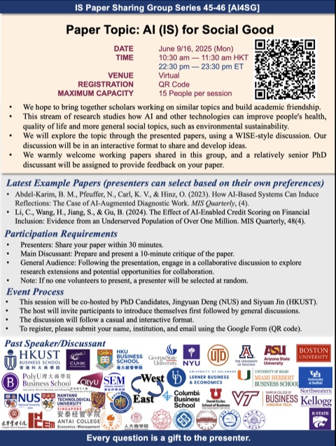</a>
  <a href="poster/IS_PSG_42_44.jpg" target="_blank" rel="noopener">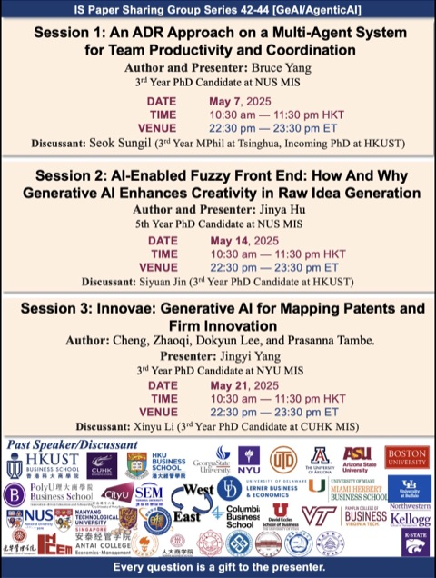</a>
  <a href="poster/IS_PSG_42_43.jpg" target="_blank" rel="noopener">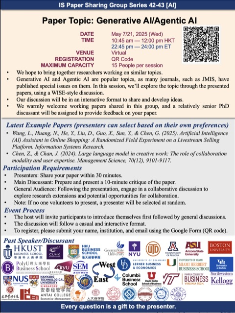</a>
  <a href="poster/IS_PSG_41.jpg" target="_blank" rel="noopener">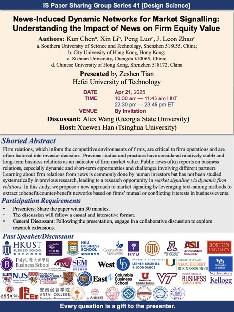</a>
  <a href="poster/IS_PSG_40.jpg" target="_blank" rel="noopener">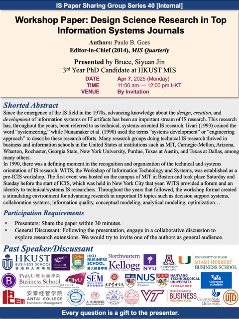</a>
  <a href="poster/IS_PSG_40_41.jpg" target="_blank" rel="noopener">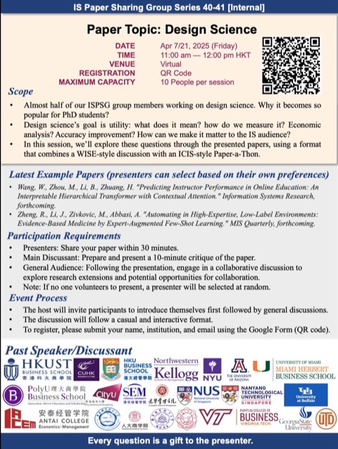</a>

Earlier sessions (30)

  <a href="poster/IS_PSG_39.jpg" target="_blank" rel="noopener">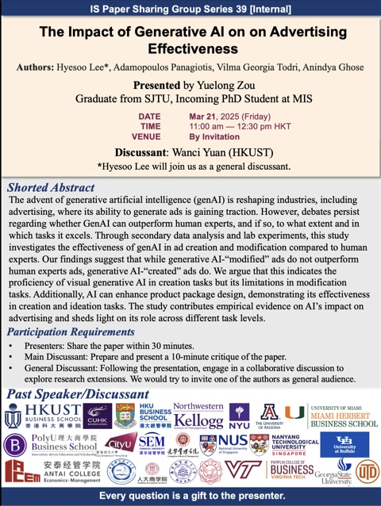</a>
  <a href="poster/IS_PSG_38.jpg" target="_blank" rel="noopener">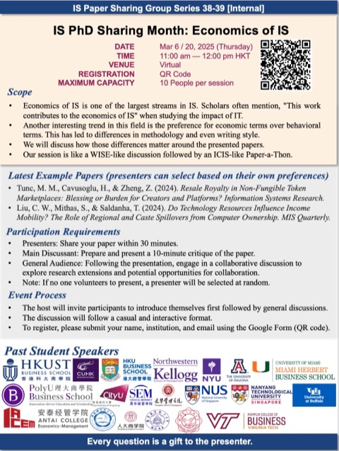</a>
  <a href="poster/IS_PSG_37.jpg" target="_blank" rel="noopener">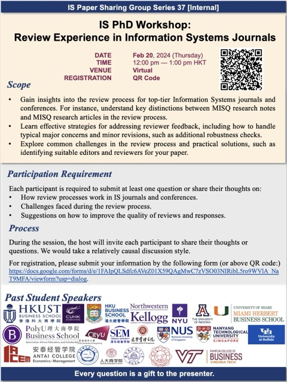</a>
  <a href="poster/IS_PSG_36.jpg" target="_blank" rel="noopener">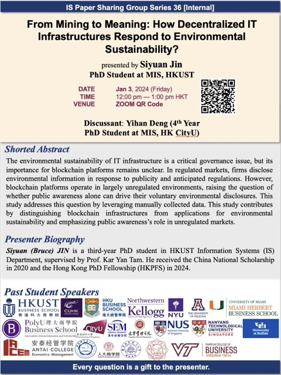</a>
  <a href="poster/IS_PSG_35.jpg" target="_blank" rel="noopener">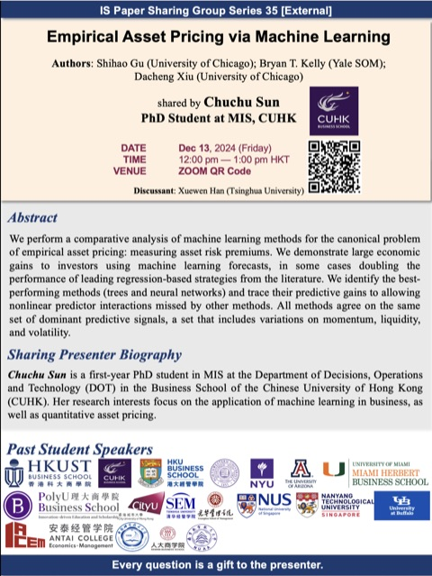</a>
  
  <a href="poster/IS_PSG_33.jpg" target="_blank" rel="noopener">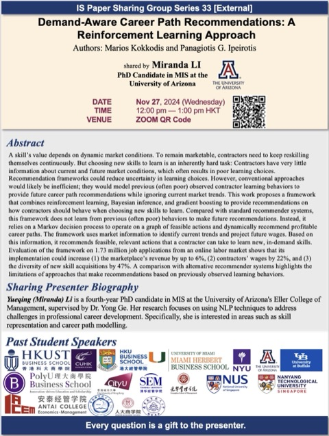</a>
  <a href="poster/IS_PSG_32.jpg" target="_blank" rel="noopener">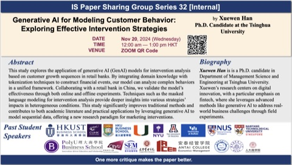</a>
  
  <a href="poster/IS_PSG_30.jpg" target="_blank" rel="noopener">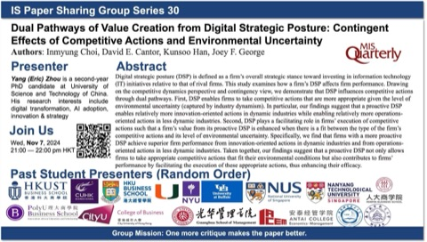</a>
  
  <a href="poster/IS_PSG_27.jpg" target="_blank" rel="noopener">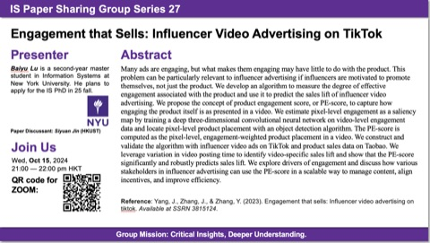</a>
  <a href="poster/IS_PSG_26.jpg" target="_blank" rel="noopener">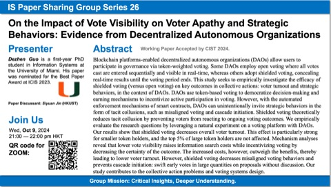</a>
  
  <a href="poster/IS_PSG_24.jpg" target="_blank" rel="noopener">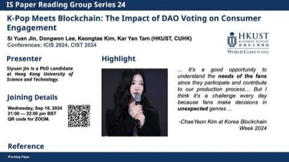</a>
  
  <a href="poster/IS_PSG_22.jpg" target="_blank" rel="noopener">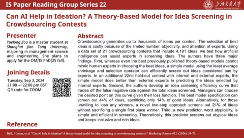</a>
  
  
  
  
  
  
  <a href="poster/IS_PSG_14.jpg" target="_blank" rel="noopener">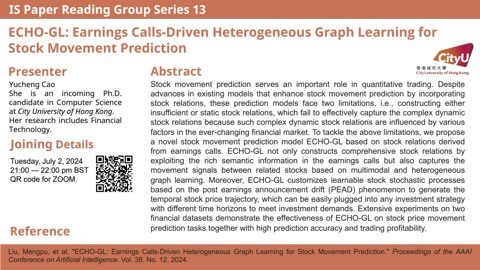</a>
  <a href="poster/IS_PSG_13.jpg" target="_blank" rel="noopener">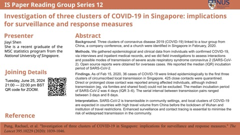</a>
  <a href="poster/IS_PSG_12.jpg" target="_blank" rel="noopener">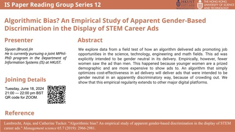</a>
  
  <a href="poster/IS_PSG_10.jpg" target="_blank" rel="noopener">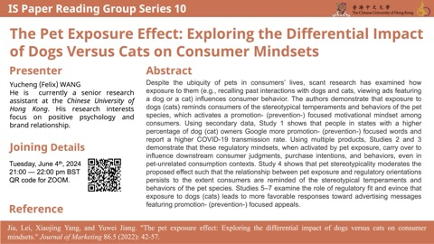</a>
  
  <a href="poster/IS_PSG_8.jpg" target="_blank" rel="noopener">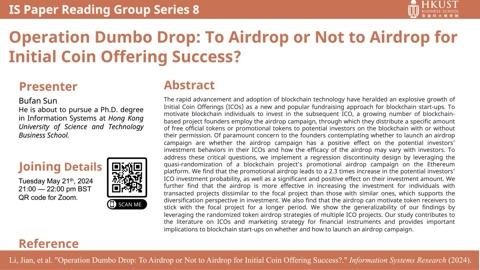</a>

<h3 class="sec" id="participants">Participants</h3>

Where participants come from, sessions 40 and 42

  <figure>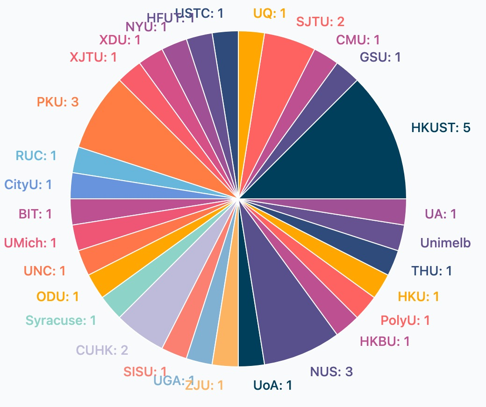<figcaption>Session 42</figcaption></figure>
  <figure>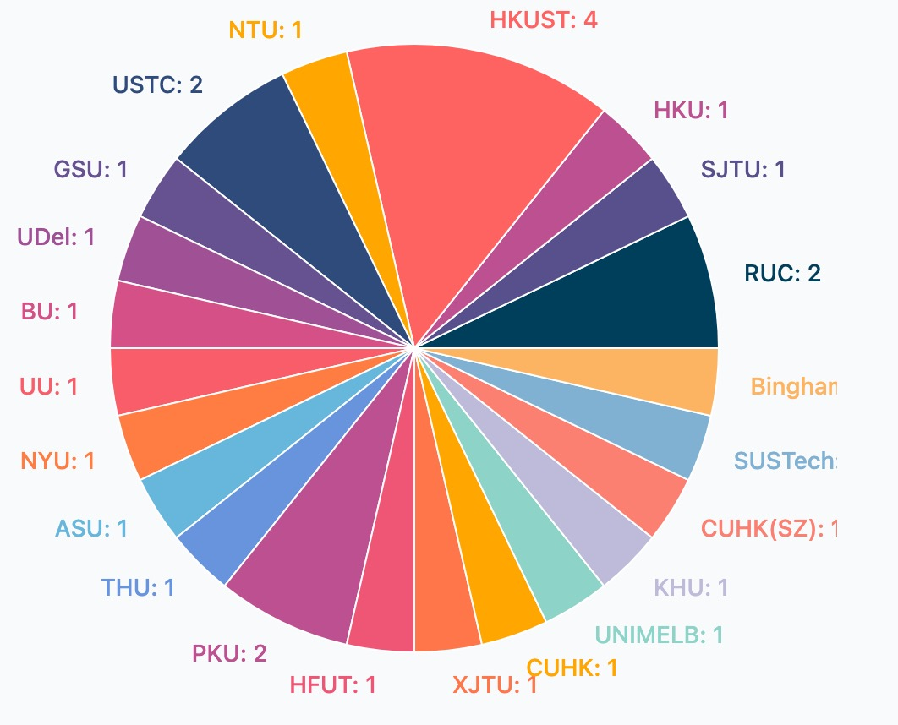<figcaption>Session 40</figcaption></figure>

<h3 class="sec" id="faculty">Faculty discussants</h3>

The group offers no payment, so we are grateful to the faculty who joined us.

Prof. Xin Li (City University of Hong Kong)

Prof. Hongchang Wang (University of Texas at Dallas)

Prof. Xinyu Fu (Georgia State University)

<h3 class="sec" id="organizers">Organizers</h3>

2025Xuewen Han (THU), Jingyuan Deng (NUS), Yihan Deng (CityU), Weibo Li (ASU), Bruce (Siyuan) Jin (HKUST)

2024Bruce (Siyuan) Jin (HKUST), Zhe Wang (PolyU)

